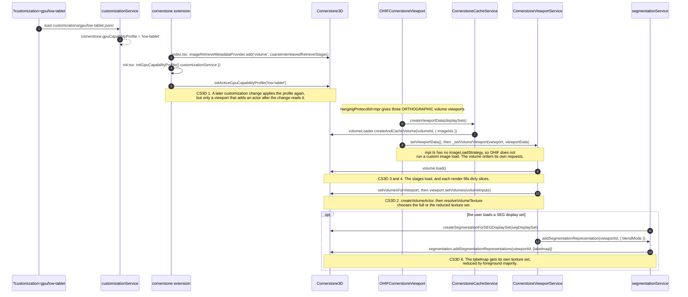

# Testing the Multi-Resolution Volume Work

Cornerstone3D branch `feat/multires-voxel-manager-base` gives a volume more than one
resolution of its voxels, and it lets a viewport draw the resolution that the device can
hold. This page says how to run OHIF against that branch, and what to look at.

Read [CS3D Integration Testing](./cs3d-integration.md) first. It describes the
`CS3D_REF` mechanism and the local link scripts in full. This page adds only what is
specific to the multi-resolution work.

## What the branch changes

A volume of many images cannot always fit in one GPU texture. A series of 2464 images
exceeds the limit of 2048 voxels on one axis that the shipped profiles assume, so before
this branch such a series could not be drawn at all on some devices, and the allocation
failed.

The branch changes three things that a tester can see:

- **A volume can hold several representations of its voxels.** One is the data as the
  loader delivered it. Another is a box average of that data on a coarser grid.
- **A viewport chooses the representation that its device can hold.** The choice is made
  once, when the viewport adds its actor, and it is read from a capability profile.
- **A reduced representation follows the load.** The loader delivers its frames over
  time, and each delivery redoes the part of the reduced data that the frame changed.

## How OHIF reaches a reduced texture

The diagram gives the OHIF side of the sequence, with the default viewports of OHIF
(`genericViewports.enabled: false`). Each `CS3D n` note names a sequence of the
Cornerstone3D page
[Volume Render Sequences](https://github.com/cornerstonejs/cornerstone3D/blob/feat/multires-voxel-manager-base/packages/docs/docs/concepts/cornerstone-core/volumeRenderSequences.md).



`CornerstoneViewportService` passes `LABELMAP_EDGE_PROJECTION_BLEND` when the viewport
blend mode is MIP. That path builds a full-resolution CPU array, and it does not reduce.
See sequence 6 of the Cornerstone3D page.

## Running it locally

This repository states `pnpm` in the `packageManager` field of `package.json`, so every
command uses `pnpm`. A command that starts with `yarn` fails with exit code 1 and the
message `This project is configured to use pnpm`.

```bash
pnpm cs3d:checkout feat/multires-voxel-manager-base
pnpm cs3d:install
pnpm cs3d:build
pnpm cs3d:link
```

Then start OHIF with `pnpm dev`. To go back to the published packages, run
`pnpm cs3d:unlink`.

A local run is necessary only to debug the code. For a test of the result, use the
deploy preview (see [Choosing a class of GPU](#choosing-a-class-of-gpu)).

## Running it in CI

Add this line to the body of your pull request, outside every code block and every HTML
comment:

```
CS3D_REF: feat/multires-voxel-manager-base
```

The branch must live in the `cornerstonejs/cornerstone3D` repository. A branch on a fork
is rejected.

## Choosing a class of GPU

A viewport reduces its texture to fit the device. To see a reduction on a device that
needs none, state a smaller class of GPU with the `?customization=` URL parameter. The
viewer ships one file for each class under
`platform/app/public/customizations/gpu/`:

| Value | Texture edge | Texture memory | Use |
| ----- | ------------ | -------------- | --- |
| `gpu/low-tablet` | 256 | 1 GB | Almost every volume reduces. The reduction is easy to see. |
| `gpu/low` | 256 | 2 GB | A weak integrated GPU. The same edge as `low-tablet`, with more memory. |
| `gpu/medium` | 2048 | 8 GB | The OHIF default. A device of the middle class. |
| `gpu/high` | 2048 | 32 GB | The Cornerstone3D default. A device of the middle class can crash under it. |
| `gpu/high-texture-4096` | 4096 | 32 GB | A control, and not a real device. |

Use the deploy preview of the pull request for the tests. Each pull request gets a
Netlify preview at `https://deploy-preview-<number>--ohif-dev.netlify.app`, and the
`CS3D_REF` line of the pull request sets the Cornerstone3D branch of that preview. This
example URL opens the 2464-image CT `Body 0.5 CE` on the preview of
[OHIF/Viewers#6295](https://github.com/OHIF/Viewers/pull/6295):

```
https://deploy-preview-6295--ohif-dev.netlify.app/viewer?StudyInstanceUIDs=1.3.6.1.4.1.14519.5.2.1.99.1071.24993177073256607564948872275593&hangingProtocolId=mpr&customization=gpu/low-tablet
```

For a local run, replace the host with `http://localhost:3000`.

Each file sets the `cornerstone.gpuCapabilityProfile` customization. The app config must
allow the prefix. `config/netlify.js` and `config/dev.js` set `customizationUrlPrefixes`,
and `config/default.js` does not. Thus a build that serves `config/default.js` rejects the
parameter.

**`gpu/high-texture-4096` states an edge of 4096, and no device is tested to render an edge
above 2048.** Some devices report a `MAX_3D_TEXTURE_SIZE` of 4096 or more, but a reported
size is not a reliable limit. A real device can therefore fail to allocate the texture. The profile is the
control of the demonstration: a series of up to 4096 images reduces nothing under
`gpu/high-texture-4096` and reduces under `gpu/high`, which shows that the reduction comes
from the limit of the device and not from a defect. Do not state the profile in
production.

## What to check

**The viewer opens a large series.** Load a CT series of more than 2048 images, for
example `Body 0.5 CE` with the example URL above. Before
this branch a device with a limit of 2048 could not allocate the texture. The series must
now display.

**A reformat holds no band and no black line.** Look at the sagittal view and at the
coronal view while the series loads. Each one must refine as the data arrives. A block of
one image repeated down the view, or a black line across it, is a defect. Report it with
the series and the number of images.

**The measurements do not change.** A viewport reads the full-resolution voxels for a
measurement, whatever resolution it draws. A length, an area and a mean value must be the
same as before the branch.

**A segmentation still aligns with its images.** A labelmap keeps its own resolution, and
a reduced CT under it must not shift it.

### See the reduction

The image alone does not prove which grid a viewport draws. Read the grid of the bound
texture in the browser console. Select a viewport, then run:

```js
const { cornerstoneViewportService, viewportGridService } = window.services;
const viewport = cornerstoneViewportService.getCornerstoneViewport(
  viewportGridService.getActiveViewportId()
);
viewport.getActors().map(({ referencedId, actor }) => ({
  referencedId,
  textureGrid: actor.getMapper().getScalarTexture?.()?.getGrid?.()?.dimensions,
}));
```

The result has one entry for each volume in the viewport. A loaded SEG adds a second
entry for the labelmap. For the series `Body 0.5 CE` (512 × 512 × 2464), expect these
grids:

| GPU class | `textureGrid` of the CT | Texture set |
| --------- | ----------------------- | ----------- |
| `gpu/high-texture-4096` | `[512, 512, 2464]` | `full-resolution/full-extent` |
| `gpu/medium`, `gpu/high`, or no customization | `[512, 512, 1232]` | `reduced-1x1x2/full-extent/average` |
| `gpu/low`, `gpu/low-tablet` | `[256, 256, 247]` | `reduced-2x2x10/full-extent/average` |

A labelmap with the dimensions of the CT gets the same grid. The name of its set ends in
`foregroundMajority` and not in `average`.

The `?debug=true` stats overlay does not show the reduction. Its `QUALITY` row reads
`volume.getVoxelQuality()` with no selector. That record describes the full-resolution
data, and not the grid that the viewport draws.

## What this branch does not do

**The resolution of a viewport does not change while a volume loads.** The device sets
the resolution when the viewport adds its actor, and one resolution is used for the whole
load. The values refine as the data arrives, so a reformat gets sharper, but the grid does
not get finer. A ladder of grids is later work.

**Nothing probes the device.** The capability profile is a stated value and not a
measurement, so a deployment that states a profile larger than the device holds gets an
allocation failure. A probe is later work.

## Where the design is written

The Cornerstone3D repository holds the design of this work. Read the pages in this order:

1. [Volume Render Strategy](https://github.com/cornerstonejs/cornerstone3D/blob/feat/multires-voxel-manager-base/packages/docs/docs/concepts/cornerstone-core/volumeRenderStrategy.md)
   describes how a viewport builds its strategies, how one render chooses among them, and
   how a derived representation follows the load. Its section "Where the code is" gives
   the file of each piece.
2. [Volume Render Sequences](https://github.com/cornerstonejs/cornerstone3D/blob/feat/multires-voxel-manager-base/packages/docs/docs/concepts/cornerstone-core/volumeRenderSequences.md)
   gives the sequence of calls as diagrams, from the profile to the fill of a reduced
   texture, and for a segmentation.
3. [Composite Voxel Manager](https://github.com/cornerstonejs/cornerstone3D/blob/feat/multires-voxel-manager-base/packages/docs/docs/concepts/cornerstone-core/compositeVoxelManager.md)
   describes how a volume holds more than one representation of its voxels.
