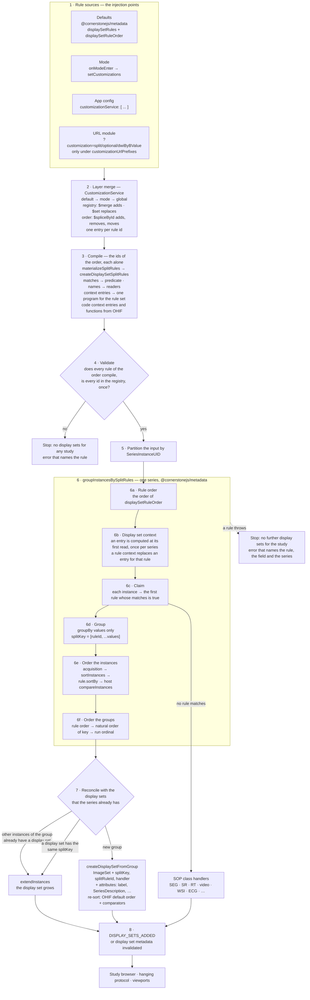
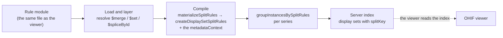

# Display set splitting — implementation requirements

**Prefix:** `SP` (split rules), groups `SP-FORM`, `SP-PIPE`, `SP-EXPR`, `SP-DEPLOY`, and `SP-SRV`.
**User requirements:** [Display set splitting — requirements](./requirements.md).
**Status:** Draft. This is the recommended approach, and it can change.

---

## 1. Scope

This document states the **implementation requirements** of display set splitting: how the work
was done, or the recommended approach. Each requirement cites the user requirements (`SP-FIX`,
`SP-DESC`, `SP-READ`, `SP-DET`, `SP-SAFE`, `SP-REUSE`) of the
[requirements specification](./requirements.md) that it satisfies. The definitions of that
document apply here.

You can change this document freely when a better approach appears. Cite the user requirements
that each change continues to satisfy. A change that needs a change of a user requirement goes
into the requirements specification first, under the change rule of that document.

---

## 2. Implementation requirements

### 2.1 The rule form — `SP-FORM`

**SP-FORM-1**
The rule set shall have two fields of the `useMetadataDisplaySet` customization. The rule
registry, `displaySetRules`, shall be a `DisplaySetRules` from `@cornerstonejs/metadata`: an object
keyed by rule id. The rule order, `displaySetRuleOrder`, shall be an array of rule ids. *Satisfies
`SP-READ-1`, `SP-READ-3`, `SP-REUSE-1`, `SP-REUSE-4`.*

**SP-FORM-2**
A rule shall have no `priority` field. The rule order alone shall set the evaluation order, and a
rule of the registry that the rule order does not name shall be off. The default order shall be the
`@cornerstonejs/metadata` `displaySetRuleOrder`, with the catch-all `unsupported` last. A custom
rule that must run before the defaults shall put its id first in the order. A custom rule between
two defaults shall put its id before the later default. A fallback rule shall put its id just
before `unsupported`. *Satisfies `SP-FIX-5`.*

> The `@cornerstonejs/metadata` compiler rejects a rule with a `priority` field
> (`unknown field 'priority'`). The default order is `video`, `ecg`, `wholeslide`,
> `singleImageModality`, `multiFrame`, `localizer`, `mixedDimensionalityBValue`, `volume3d`,
> `defaultImageRule`, `segmentation`, `rtStructureSet`, `parametricMap`, `structuredReport`,
> `encapsulatedDocument`, `bulkAnnotation`, `chart`, `unsupported`.

**SP-FORM-3**
A rule shall use the fields of `RawSplitRule`, and the reference documentation shall define each
field. *Satisfies `SP-DESC-2`.*

| Field | Form |
| --- | --- |
| `description` | Text that states what the rule does |
| `groupId` | The group of related rules that the rule belongs to (`SP-PIPE-15`). Default: the rule id |
| `context` | Context entries for this rule only — a fixed value, an expression string, `{ template }`, a group `{ function, args }`, or a declaration `{ attribute }`. See [series context](./series-context.md) |
| `matches` | A map of name to test, and every entry must hold. A name is a DICOM keyword or a context name. There is no `all`, `any` or `not` |
| `groupBy` | A list of names |
| `sortBy` | A list of names, in ascending order, or `{ sortFunction }` |
| `attributes` | Attribute values keyed by attribute name — a name, a fixed value, `{ template }`, or `{ expression }` |

**SP-FORM-4**
`createDisplaySetSplitRules` shall compile the rule set, with the `metadataContext` customization
as the `context` option. OHIF shall supply its series functions and sort functions to it by name,
and shall supply no context entry that is code. *Satisfies `SP-READ-1`,
`SP-REUSE-1`.*

**SP-FORM-7**
`createDisplaySetSplitRules` shall reject a rule that has an unknown key, or a form that its field
does not accept, anywhere in the rule. The error shall name the rule, the path of the key in the
rule, and the keys or forms that the field accepts. *Satisfies `SP-SAFE-7`, `SP-READ-5`.*

> An internal table of `@cornerstonejs/metadata` defines each field of a rule: the forms
> that the field accepts, and the arguments that the compiled function gets, for example
> `(instance, context)` for `matches` and `(a, b, context)` for a `sortBy` function. The compiler
> reads this table, and it also checks each name. A typo such as `matchs` or `Modallity` was
> accepted before, and the rule then claimed every instance or no instance.

**SP-FORM-8**
A rule that code supplies may hold a function at a function place of the data form: a whole
`matches`, the test of one `matches` entry, a `groupBy` entry, a `sortBy` entry, a whole
`attributes`, or one attribute value. The compiler shall use the function as it is. A rule that the
compiler has already compiled is not a valid entry. *Satisfies `SP-REUSE-1`.*

**SP-FORM-5**
A URL rule module shall be JSONC, so that it can carry comments, and each rule shall carry a
`description`. *Satisfies `SP-DESC-3`, `SP-READ-2`.*

**SP-FORM-6**
A rule module that needs the splitter shall name `split/enableNewSplit` in its `requires` list.
*Satisfies `SP-DESC-4`.*

> The raw selector form is the one definitive rule format, for the viewer and for a server.

### 2.2 The pipeline — `SP-PIPE`

The flowchart shows every stage that a rule passes through, from its source to a display set. The
numbers match the requirements below. Stage 3 and the stages in box 6 are in
`@cornerstonejs/metadata`. The other stages are in OHIF.



**The trace of one rule.** This example rule puts each b-value of a diffusion MR series into its
own display set. The file `rules/optional/dwiByBValue.jsonc` of `@cornerstonejs/metadata` holds
the rule. The file is an `immutability-helper` spec over `{ displaySetRules, displaySetRuleOrder }`.
The OHIF build copies the file to the module `split/optional/dwiByBValue.jsonc`, and applies the
spec to the `useMetadataDisplaySet` customization. The copy below has the data of that file,
without its comments. The file is the reference.

```jsonc
{
  "displaySetRules": {
    "$merge": {
      "dwiByBValue": {
        "description": "Diffusion MR: one display set for each b-value.",
        "context": {
          "bValue": "isLocalizer ? null : Number(DiffusionBValue)",
          "isDiffusion": "series.instances.max(bValue) > 0"
        },
        "matches": {
          "Modality": "MR",
          "isDiffusion": true,
          "isImage": true,
          "isMultiFrame": false,
          "isLocalizer": false,
          "DiffusionBValue": { "notNull": true }
        },
        "groupBy": ["SeriesInstanceUID", "bValue"],
        "sortBy": ["displaySet.sliceDistance", "InstanceNumber"],
        "attributes": {
          "SeriesDescription": { "template": "{SeriesDescription} b={DiffusionBValue}" }
        }
      }
    }
  },
  "displaySetRuleOrder": {
    "$spliceById": [["mixedDimensionalityBValue", 0, "dwiByBValue"]]
  }
}
```

The table follows the rule through each stage, for an MR series of 90 instances: 30 slices at each
of the b-values 0, 500, and 1000.

| Stage | What happens to `dwiByBValue` |
| --- | --- |
| 1 | The URL `?customization=split/optional/dwiByBValue` loads the module. Its `requires` loads `split/enableNewSplit` first. |
| 2 | `$merge` adds the key `dwiByBValue` to the registry, and `$spliceById` puts the id just before the default `mixedDimensionalityBValue` rule. The default rules stay. |
| 3 | `createDisplaySetSplitRules` compiles `matches` into one predicate, the rule `context` into entries of the context program, and the template into one value reader. |
| 4 | Each id of the order is in the registry, and every rule compiles, so display set creation continues. |
| 6a | The order is the default order, with `dwiByBValue` just before `mixedDimensionalityBValue`, and `unsupported` last. No earlier default rule claims a single-frame MR image that is not a localizer. |
| 6b | `isDiffusion` is true: the largest b-value of the series is above 0. A series with b=0 only is not a diffusion series for this rule. |
| 6c | All 90 instances have `DiffusionBValue`, so `dwiByBValue` claims all of them. |
| 6d | Three groups, with the keys `["dwiByBValue", <SeriesInstanceUID>, 0]`, `[…, 500]`, and `[…, 1000]`. |
| 6e | In each group, the order is the distance of each slice along the normal of the image plane (`displaySet.sliceDistance`), and then `InstanceNumber`. |
| 6f | The natural order of the keys puts the groups in the order b=0, b=500, b=1000. |
| 7 | The three groups are new. `createDisplaySetFromGroup` makes three display sets, with the descriptions `<description> b=0`, `b=500`, and `b=1000`. |
| 8 | The study browser shows three items. Each item gets its own window level. |

**SP-PIPE-1**
The customization service shall merge the rule layers in the order default, mode, global, and a
later layer shall edit a rule by its id. *Satisfies `SP-FIX-5`, `SP-REUSE-4`.*

**SP-PIPE-19**
The customization service shall register the `$spliceById` command, with `spliceById` of
`@cornerstonejs/metadata`. Each entry shall be `[id, deleteCount, ...items]`. The position shall be
the index of the item that equals the id, or of the item whose `id` equals it. An unknown id, and a
position that is not a string, shall be an error. Each entry shall find its position after the edits
of the earlier entries. The standard `$splice` shall stay unchanged. *Satisfies `SP-FIX-5`.*

> A separate command name, and not a string position of `$splice`: plain `immutability-helper` reads
> a string position of `$splice` as `0` and gives no error, but it rejects an unknown command. So a
> host without the command fails, and does not build another order.

> So a layer can turn off, replace, or move one default rule by its id, and does not depend on
> the index of the rule: `[['volume3d', 0, 'myRule']]` inserts `myRule` before `volume3d`,
> `[['ecg', 1]]` removes `ecg`, and `[['volume3d', 1, 'myVolume']]` replaces `volume3d`. An unknown
> id throws, so a
> layer for a default rule that a later release renames fails with an error, and does not do
> nothing.

**SP-PIPE-2**
OHIF shall compile a rule set once, with `createDisplaySetSplitRules`, and use the compiled rules
again until the `displaySetRules` value, the `displaySetRuleOrder` value, or the `metadataContext`
value changes. *Satisfies `SP-DET-1`.*

> A mode that defines other rules, or another order, gives a new object, and that object compiles
> again, and so does a new `metadataContext` value. A change of `seriesFunctions` or
> `sortFunctions` alone does not compile the rules again, so a mode that changes them must also
> give a new `displaySetRules` object.

**SP-PIPE-3**
The compile step shall compile each id of the rule order alone, so that it can name every rule
that fails. The compile step shall not compile a rule of the registry that the order does not name.
*Satisfies `SP-SAFE-7`.*

> `compileSplitRules(registry, order, options)` takes each id of the order, gets the rule with
> `materializeSplitRules(registry, [id])`, and compiles it. The compile step compiles every rule
> of the order, also a rule that has functions. The compiler keeps a function as it is, and
> compiles the data fields next to it. A rule id of `__proto__` is an error, because the id cannot
> be a key of a plain object.

**SP-PIPE-13**
IF any rule of the rule order does not compile, or an id of the rule order is not in the registry,
THEN the display set service shall create no display sets for any
study, not even SEG or SR display sets, and shall show an error through the UI notification
service. *Satisfies `SP-SAFE-7`.*

> `compileSplitRules` returns `{ rules, errors }`, and it does not drop a rule. A registry that is
> not a keyed object, or an order that is not an array, is also an error. While `errors` is not
> empty, `makeDisplaySetForInstances` returns no display sets, and does not give the instances to
> the SOP class handlers. The service shows one error notification that stays on screen until the
> user closes it. The block clears when the registry or the order changes, and on mode exit.

**SP-PIPE-14**
The compile step shall wrap each function of each rule, so that an error at run time names the rule
and the field, for example `matches`, `groupBy[1]`, `compareInstances` (the compiled
`sortBy`), or `customAttributes` (the compiled `attributes`). The wrap shall
apply to a rule compiled from data and to a rule that code supplies. *Satisfies `SP-SAFE-3`.*

> The host `sortInstances` and `compareInstances` of the customization are not wrapped. An error in
> one of them stops display set creation for the study, as `SP-PIPE-9` requires, but the error does
> not name a rule.

**SP-PIPE-4**
The display set service shall give the engine one series at a time. *Satisfies `SP-DET-1`.*

**SP-PIPE-5**
The engine shall give each instance to the first rule, in rule order, whose `matches` is
true. *Satisfies `SP-FIX-6`, `SP-DET-1`.*

**SP-PIPE-6**
The engine shall namespace each split key with the rule id, so that two rules never merge their
groups. *Satisfies `SP-READ-4`, `SP-DET-1`.*

**SP-PIPE-7**
The engine shall order the instances of a group by acquisition order, then by `sortInstances`,
then by the rule's `sortBy`, then by the host `compareInstances`. A comparator that
returns `0` shall leave the earlier order. *Satisfies `SP-FIX-4`, `SP-DET-2`.*

**SP-PIPE-8**
The engine shall give each instance that no rule claims to the SOP class handlers.
*Satisfies `SP-FIX-6`, `SP-SAFE-4`.*
With the default rules, no instance reaches this step: the `unsupported` rule has no `matches`, so
it claims each instance that no other rule claims. The step applies to a rule order without
`unsupported` (`SP-PIPE-20`). The `unsupported` rule gives the result of `SP-FIX-9`.

**SP-PIPE-20**
A deployment may remove `unsupported` from the rule order. The compile step shall accept a rule
order without `unsupported`, and the display set service shall then give each instance that no
rule claims to the SOP class handlers of the mode (`SP-PIPE-8`). *Satisfies `SP-FIX-11`.*

> For example, `{ "displaySetRuleOrder": { "$spliceById": [["unsupported", 1]] } }` removes the
> catch-all. An instance of a private SOP class then shows with the SOP class handler of its
> extension, as with the rules off.

**SP-PIPE-21**
WHEN an id occurs more than once in the rule order, the compile step shall keep the first place of
the id, drop the later places, and write one console warning that names the id. *Satisfies
`SP-FIX-5`.*

> A repeated id is the same rule, so its later place can never claim an instance. Two modules that
> add the same rule, for example `split/usTimeClusters` and `split/optional/usTimeClusters`, each
> insert the id. Before this rule, the repeated id stopped all display set creation.

**SP-PIPE-22**
A split module that adds a rule shall put its id just before the default rule that it refines
(`$spliceById`), and not first (`$unshift`), unless the rule must precede every default rule.
*Satisfies `SP-FIX-5`, `SP-FIX-6`.*

> Then the order of the rules does not depend on the load order of the modules. `split/decimation`
> stays first, because it applies to any large single-frame series.

**SP-PIPE-9**
IF the engine throws for a series, THEN the display set service shall create no further display
sets for the study, and shall show an error through the UI notification service that names the
rule and the series. *Satisfies `SP-SAFE-3`.*

> `DisplaySetService` catches an error from the engine, from `createDisplaySetFromGroup`, and from
> `extendInstances`. It records the failure for the `StudyInstanceUID`, and then creates no further
> display sets for that study, and gives no further instances of that study to the SOP class
> handlers. The display sets that exist stay (`SP-DET-3`). Other studies continue. The error is a
> `SplitRuleRunError` that names the rule and the field (`SP-PIPE-14`), and the notification also
> names the series. The block clears when the registry or the order changes, and on mode exit.

**SP-PIPE-10**
The display set service shall put a new instance into the display set that holds the other
instances of its group, else into the display set with the same split key, else into a new
display set. *Satisfies `SP-DET-3`, `SP-DET-4`.*

**SP-PIPE-16**
WHEN a display set grows, the display set factory shall compute the attributes of the grown image
list before it sorts the images, and shall compute the attributes that depend on the order again
after the sort. *Satisfies `SP-DET-1`.*

> OHIF's default sort reads `isReconstructable` to choose patient-position order or instance-number
> order. One slice is not reconstructable, but more slices can be. A sort that reads the value of
> the earlier image list can give a different order from a load of all of the instances. The
> `instance`, the `messages`, and the thumbnail depend on the final order. The initial build uses
> the same sequence, so a display set that grew has the same order as a new one.

**SP-PIPE-11**
The display set factory shall record `splitKey`, `splitRuleId`, and `splitGroupId` on each
display set, and shall not let the `attributes` of a rule overwrite those three attributes or
`extendInstances`. *Satisfies `SP-READ-4`, `SP-READ-6`, `SP-DET-3`.*

> `@cornerstonejs/metadata` protects the three split attributes. `NOT_COPIED` in
> `makeDisplaySetFromInstanceGroup.ts` holds `extendInstances`, and also `__proto__`, because an
> assignment of `__proto__` replaces the prototype of the display set. A
> user and a hanging protocol read `splitRuleId` to find the rule that made a display set
> (`SP-READ-4`), so a rule must not be able to change `splitRuleId`.

**SP-PIPE-18**
No default rule and no OHIF split module shall set viewport types. A custom rule may set
`viewportTypes`, and OHIF shall keep them on the display set as data, and shall not read them. The
handler of the display set shall decide how OHIF shows it, from the instance data: the image part of the display set factory for a rule with no handler
or the `image` handler, and the `extendDisplaySet` of the SOP class handler for the other names.
*Satisfies `SP-SAFE-4`.*

**SP-PIPE-15**
A rule may have a `groupId`. The display set factory shall set `splitGroupId` to the `groupId` of
the rule, else to the id of the rule. *Satisfies `SP-READ-6`.*

> So `splitGroupId` equals `splitRuleId` unless a deployment groups rules. The group id does not
> change the split: the groups and the split keys stay per rule id (`SP-PIPE-6`). For example,
> the rules `mgTomo`, `mgLegacy`, and `mgSplit` can all have `"groupId": "mammo"`, and a hanging
> protocol then matches `splitGroupId` equal to `mammo`.

**SP-PIPE-12**
The default `displaySetRules` and `displaySetRuleOrder` shall be the `@cornerstonejs/metadata`
default registry and default order, with no OHIF copy or change of a rule. A rule shall test the SOP class with a list of the `metadataContext`, for
example `isImage`. *Satisfies `SP-SAFE-4`, `SP-REUSE-1`.*

**SP-PIPE-17**
A rule may name a generic `handler`. A SOP class handler shall declare the names that it serves in
`handlerNames`, and shall have an `extendDisplaySet` function; a handler with `handlerNames` and
no `extendDisplaySet` is an error when the mode registers it. The first handler of the mode that
declares a name shall serve it. A name that no handler of the mode declares shall give the
unsupported display set, and one console warning for each name. *Satisfies `SP-SAFE-4`.*

> The display set factory builds each display set in three steps: the `@cornerstonejs/metadata`
> `createDisplaySetFromGroup`, the OHIF generic step (its image part only for no handler or the
> `image` handler), and the handler's `extendDisplaySet(displaySet, { addedInstances,
> servicesManager, extensionManager })`. With the rules off, the SOP class handlers run as before.

### 2.3 The expression language — `SP-EXPR`

> The expression language is not specific to split rules. Its reference documentation is the
> [Split Rule Expressions](../../../platform/services/customization-service/functionExpressions.md)
> page. The requirements below state only what split rules need from the language.

**SP-EXPR-1**
A rule should use a name and a test in `matches`, and should put an expression in a context entry
only where no test fits. *Satisfies `SP-READ-1`, `SP-DESC-2`.*

**SP-EXPR-2**
The expression compiler shall live in `@cornerstonejs/metadata` (`compileExpression`, part of the
safe functions). *Satisfies `SP-REUSE-1`.*

**SP-EXPR-3**
The compiler shall not use `eval` or `new Function`, and shall reject `__proto__`, `constructor`,
and `prototype` when it parses an expression. *Satisfies `SP-SAFE-1`.*

**SP-EXPR-4**
`collectIdentifiers` shall report the attributes that an expression reads. *Satisfies
`SP-READ-5`, `SP-REUSE-5`.*

**SP-EXPR-5**
Each name in an expression shall be a DICOM keyword or a context name, and any other name shall be
a compile error. A bare keyword reads an attribute of the instance. `series.instances.count(x)` and
the other aggregates run over the instances of the series, and in `attributes` only,
`displaySet.instances.*` runs over the display set. *Satisfies `SP-SAFE-2`, `SP-FORM-7`.*

**SP-EXPR-6**
The compiled readers shall read an attribute of an instance, and a context value, only as an own
property. *Satisfies `SP-SAFE-2`.*

> A bare name inside an expression can still read a prototype member, for example `toString`.
> That is a known gap.

> `SP-SAFE-6` has no mechanism today. It is a future item. See §6 item 9 of the [requirements](./requirements.md).

### 2.4 Rule files in a deployment — `SP-DEPLOY`

**SP-DEPLOY-1**
Example and deployment rule modules shall go in `platform/app/public/customizations/split/`, one
concern per file, named for the problem that the file fixes. *Satisfies `SP-READ-2`.*

**SP-DEPLOY-2**
A rule module shall state in its header comment the problem, the series that the rule changes, and
the URL that loads the module. *Satisfies `SP-DESC-3`.*

**SP-DEPLOY-3**
A rule that must take instances before the defaults shall put its id first in the rule order
(`$unshift`), or before the default rule that it must precede (`$spliceById` with the id of that rule),
and shall gate on a list of the `metadataContext` such as `isImage`, on `SOPClassUID`, or on
`Modality`. *Satisfies `SP-FIX-6`, `SP-SAFE-4`.*

### 2.5 Reuse by a server — `SP-SRV`



**SP-SRV-1**
A server shall compile rules with `@cornerstonejs/metadata` only, and shall not need `@ohif/core`.
*Satisfies `SP-REUSE-1`, `SP-REUSE-5`.*

**SP-SRV-2**
A server index shall record the `splitKey` of each display set, so that the viewer can match its
display sets to the index. *Satisfies `SP-REUSE-2`, `SP-DET-3`.*

**SP-SRV-3**
Each split file shall use only the standard `immutability-helper` commands and `$spliceById`
(`SP-PIPE-19`), and no `$filter`. For each split file, the rules from `immutability-helper` with
`spliceById` registered, `JSON5`, `materializeSplitRules` and `createDisplaySetSplitRules`, with no
other OHIF code, shall equal the rules from `CustomizationService`. *Satisfies `SP-REUSE-2`.*

> A split file shall not put an id in `$splice`. Plain `immutability-helper` reads a string position
> as `0`, so a server gets another order with no error.

**SP-SRV-4**
The SOP class tests shall be lists of the `metadataContext` customization, with the
`@cornerstonejs/metadata` names, so that one overlay such as
`{ "metadataContext": { "imageSopClassUids": { "$push": ["1.2.3.4"] } } }` works in OHIF and on a
server. The OHIF default value adds only the private chart SOP class to `chartSopClassUids`.
*Satisfies `SP-REUSE-2`, `SP-SAFE-4`.*

**SP-SRV-5**
OHIF shall add a new instance to the display sets without a re-split (`SP-DET-3`). A server
re-splits the whole series when an instance arrives. The documentation shall state this
difference. *Satisfies `SP-REUSE-2`.*

---

## 3. Traceability

| Requirement group | Source |
| --- | --- |
| `SP-FORM`, `SP-PIPE`, `SP-EXPR` | The implementation in [OHIF/Viewers#6137](https://github.com/OHIF/Viewers/pull/6137), and `DisplaySetRules` in `@cornerstonejs/metadata` |
| `SP-SRV` | The decision that the raw selector form is definitive (§6 item 1 of the [requirements](./requirements.md)), and the design of one rule set for the viewer and the server ([cornerstonejs/cornerstone3D#2861](https://github.com/cornerstonejs/cornerstone3D/pull/2861)) |

## 4. Verification

| Requirement | Test |
| --- | --- |
| `SP-PIPE-5`..`SP-PIPE-8`, `SP-PIPE-12` | `extensions/default/src/displaySetSplitting/urlSplitModules.test.ts`, and the default rule tests of `@cornerstonejs/metadata` |
| `SP-PIPE-17` | `DisplaySetService.test.ts` ("handler names"), and `makeDisplaySetFromInstanceGroup.test.ts` (the image part) |
| `SP-SRV-3` | `urlSplitModules.test.ts` (one test for each split file) |
| `SP-SRV-4` | `extensions/default/src/customizations/metadataContextCustomization.test.ts` |
| `SP-PIPE-4`, `SP-PIPE-10` | `platform/core/src/services/DisplaySetService/DisplaySetService.test.ts` |
| `SP-PIPE-11`, `SP-PIPE-15`, `SP-PIPE-16` | `extensions/default/src/displaySetSplitting/makeDisplaySetFromInstanceGroup.test.ts`, and the `groupId` tests in `displaySetRules.test.ts` of `@cornerstonejs/metadata` |
| `SP-FORM`, `SP-PIPE-1` | `extensions/default/src/customizations/metadataContextCustomization.test.ts` |
| `SP-PIPE-19` | `platform/core/src/services/CustomizationService/CustomizationService.test.js`: "applies $spliceById with an id as the position" |
| `SP-PIPE-20` | `DisplaySetService.test.ts`: "falls unmatched instances through to the legacy handlers" |
| `SP-PIPE-21` | `compileSplitRules.test.ts`: "an id of the order that is not in the registry is an error; a repeated id keeps its first place" |
| `SP-PIPE-22` | `optionalRules.test.ts` of `@cornerstonejs/metadata`: "gives one rule order for any load order of the files" |
| `SP-EXPR`, `SP-FORM-7`, `SP-FORM-8` | The safe function and raw selector tests of `@cornerstonejs/metadata` (`compile.test.ts`, `displaySetRules.test.ts`, `expression.test.ts`) |
| `SP-PIPE-2`, `SP-PIPE-3`, `SP-PIPE-14` | `platform/core/src/services/DisplaySetService/compileSplitRules.test.ts` |
| `SP-PIPE-9` | `DisplaySetService.test.ts`, the run-time part of `split rule errors` |
| `SP-PIPE-13` | `compileSplitRules.test.ts` and `DisplaySetService.test.ts`, the compile part of `split rule errors` |
| `SP-SRV-1`, `SP-SRV-2` | *Pending* — the server implementation is future work |
