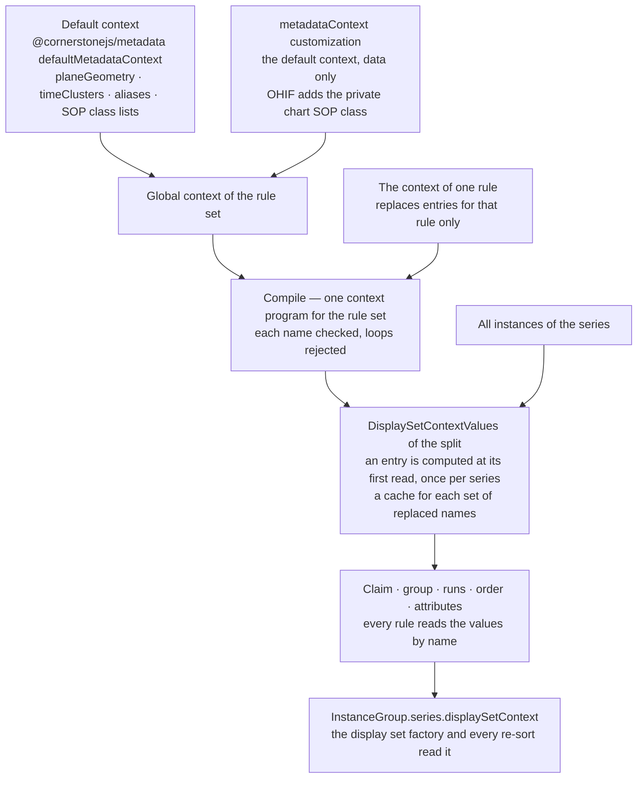

# Display set splitting — series context implementation requirements

**Prefix:** `SP` (split rules), groups `SP-CTX`, `SP-SFN`, and `SP-EXM`.
**User requirements:** [Display set splitting — series context](./series-context.md), and
[Display set splitting — requirements](./requirements.md).
**Status:** Draft. This is the recommended approach, and it can change.

---

## 1. Scope

This document states the **implementation requirements** of the series context: how the work was
done, or the recommended approach. Each requirement cites the user requirements (`SP-SUM` of the
[series context](./series-context.md) specification, and the groups of the
[requirements](./requirements.md) specification) that it satisfies. The definitions of those
documents apply here.

You can change this document freely when a better approach appears. Cite the user requirements
that each change continues to satisfy. A change that needs a change of a user requirement goes
into the user specification first, under the change rule of that document.

---

## 2. Implementation requirements

### 2.1 The shared series context — `SP-CTX`

The flowchart shows how the engine computes the values of the display set context for one split.



**SP-CTX-1**
`createDisplaySetSplitRules` shall compile one context program for a rule set: the entries of
`defaultMetadataContext`, then the entries of `options.context` over them. A rule shall
read a value by its name. *Satisfies `SP-SUM-1`, `SP-SUM-5`.*

**SP-CTX-2**
The engine shall compute an entry at its first read, one time for each series, and every rule that
does not replace the entry, or an entry that it reads, shall read the same value. *Satisfies
`SP-SUM-5`.*

> The cache key of an entry holds only the replaced names that the entry reads. So two rules that
> replace nothing share one computation of `planeGeometry`.

**SP-CTX-3**
The context of a rule shall replace a global entry of the same name for that rule only, also inside
the global entries that the rule reads, and it can define a new name. *Satisfies `SP-SUM-6`,
`SP-SUM-10`.*

> `"context": { "timeClustersMaxGap": 20 }` changes the gap of `timeClusters` for one rule, and
> `sweepStart` and the other aliases follow.

**SP-CTX-4**
A context entry in the data form shall have one of five forms. *Satisfies `SP-SUM-1`,
`SP-SUM-8`.*

| Form | Value |
| --- | --- |
| a number, a boolean, `null` or an array | A fixed value |
| a string | An expression. `series.instances.count(x)`, `.min(x)`, `.max(x)` and `.sum(x)` run over the instances of the series |
| `{ template }` | Text |
| `{ function, args? }` | A group: the value of a named series function, called with `(instances, { args })` |
| `{ attribute, vr?, vm? }` | A declaration of an attribute that the DICOM dictionary does not hold |

**SP-CTX-5**
A loop of context entries, an unknown name, and an unknown field of a group shall be compile
errors. *Satisfies `SP-SUM-6`, `SP-SAFE-7`.*

**SP-CTX-6**
`createDisplaySetSplitRules` shall take named series functions as `options.seriesFunctions`, in
addition to the built-in ones. A group that names an unknown function shall be a compile error
that names the rule, the path, and the known functions. OHIF shall pass the `seriesFunctions` of
the `useMetadataDisplaySet` customization, and the `metadataContext` customization as `context`. *Satisfies `SP-SUM-9`,
`SP-FORM-4`.*

**SP-CTX-7**
The display set factory shall pass the series context to `customAttributes` (the compiled
`attributes`) as `options.series`, and an attribute value shall read a context value by its name.
*Satisfies `SP-SUM-7`.*

**SP-CTX-8**
`DisplaySetService` shall pass the series context of a re-split to `extendInstances`, whichever
rule placed the new instances. *Satisfies `SP-DET-3`, `SP-SUM-1`.*

**SP-CTX-9**
A series function that gives a result for each instance shall give a map keyed by
`SOPInstanceUID`, else by `imageId`, and shall declare the field as an instance field. A rule
shall read the field by its path or its alias, for example `sliceIndex`, and gets the value of the
instance at hand. *Satisfies `SP-SUM-8`.*

**SP-CTX-10**
A series value that a rule uses in `groupBy` shall not be an ordinal. It shall be a value that
stays the same when a later group gets new instances, for example the start time of a sweep.
*Satisfies `SP-DET-3`.*

> The split key holds the `groupBy` values. An ordinal of a sweep changes when an earlier sweep
> arrives, and the display set then gets a different key.

**SP-CTX-11**
A value that only one rule needs should be an entry of the context of that rule. A value that two
or more rules must share should be a global entry. *Satisfies `SP-SUM-5`, `SP-SUM-6`.*

### 2.2 Series functions — `SP-SFN`

**SP-SFN-1**
The series functions shall be in `@cornerstonejs/metadata`, so that a server can use them without
OHIF. *Satisfies `SP-REUSE-1`, `SP-SRV-1`.*

**SP-SFN-2**
A series function shall be pure, and its result shall not depend on the order of the instances.
Its result shall be plain data: numbers, booleans, arrays, and maps. *Satisfies `SP-DET-2`,
`SP-REUSE-2`.*

**SP-SFN-3**
`planeGeometry` shall compute the slice lattice of a series in these steps. *Satisfies
`SP-SUM-2`, `SP-SUM-3`.*

1. The dominant orientation is the most frequent `ImageOrientationPatient`, rounded to 1e-3. A tie
   goes to the smaller text. The normal comes from the instance of that orientation with the
   smallest key.
2. Each instance of that orientation projects its `ImagePositionPatient` on the normal. The
   spacing is the most frequent gap between two consecutive distinct positions, rounded to
   0.01 mm. A tie goes to the smaller gap.
3. The anchor is the position that puts the most positions on the lattice. A tie goes to the lower
   position. So one extra slice at the edge does not move the lattice.
4. A position is on the lattice when its offset from the anchor, in units of the spacing, is
   within `args.tolerance` (default `0.1`) of an integer.
5. Index 0 is the lowest regular position, and `origin` is its position.

The result is `{ normal, origin, spacing, regularCount, irregularCount, positions, complete,
duplicates, distance, index }`. `distance` holds the distance in mm from the origin, for each
instance of the dominant orientation. `index` holds the lattice position of each regular
instance. `complete` is true when no lattice position between the first and the last is empty.

**SP-SFN-4**
`timeClusters` shall read the time of each instance from `AcquisitionDateTime`, else from
`AcquisitionDate` and `AcquisitionTime`, else from `ContentDate` and `ContentTime`. It shall sort
the times, with the key as a tie break, and shall start a new cluster after a gap of more than
`args.maxGap` seconds (default `30`). *Satisfies `SP-SUM-4`.*

The result is `{ time, start, first, clusters, untimedCount }`. `start` holds the start time of
the cluster of each instance, and so satisfies `SP-CTX-10`.

> No public DICOM date and time parser exists in the packages that `@cornerstonejs/metadata`
> uses: `@cornerstonejs/calculate-suv` has `parseDA` and `parseTM`, but its index does not
> export them. So `seriesFunctions.ts` holds a small parser, `dicomDateTimeToSeconds`. It ignores
> the time zone offset of a `DT`, and without a date it gives the time of day.

### 2.3 Example rule modules — `SP-EXM`

`SP-EXM-1` and `SP-EXM-3` are modules in `platform/app/public/customizations/split/`, and follow
`SP-DEPLOY-1` and `SP-DEPLOY-2`. `urlSplitModules.test.ts` compiles each module, and checks the
display sets of one series for each module. `SP-EXM-2` is an optional file of
`@cornerstonejs/metadata`, and `optionalRules.test.ts` of that package checks it.

**SP-EXM-1** — `split/regularVolume.jsonc`. *Satisfies `SP-SUM-2`, `SP-SUM-5`, `SP-SUM-7`.*

```jsonc
"regularVolume": {
  "context": {
    "mixesIrregular": "planeGeometry.regularCount >= 3 && planeGeometry.irregularCount > 0 && planeGeometry.complete",
    "isRegularSlice": "sliceIndex != null"
  },
  "matches": {
    "isImage": true,
    "Modality": ["CT", "MR", "PT", "NM"],
    "mixesIrregular": true,
    "isRegularSlice": true
  },
  "groupBy": ["SeriesInstanceUID"],
  "sortBy": ["displaySet.sliceDistance"],
  "attributes": {
    "SeriesDescription": { "template": "{SeriesDescription} ({displaySet.sliceSpacing} mm)" }
  }
}
```

The module adds the rule to the registry with `$merge`, and puts its id first in the rule order
with `"displaySetRuleOrder": { "$unshift": ["regularVolume"] }`.

The module also adds the rule `irregularImages` to the registry, but not to the rule order, so the
rule is off. With its id in the order, for example
`{ "$splice": [["volume3d", 0, "irregularImages"]] }`, that rule puts the other images into one
stack, with `"isRegularSlice": false`. Both rules read the global `planeGeometry` group and replace
no entry that it reads, so the engine computes the lattice once (`SP-CTX-2`).

**SP-EXM-2** — the optional file `volumePositionOrder` of `@cornerstonejs/metadata`
(`rules/optional/volumePositionOrder.jsonc`, loaded as
`?customization=split/optional/volumePositionOrder`). *Satisfies `SP-SUM-3`.*

The file changes one field of the default `volume3d` rule with the standard `$set` command, so
the rule keeps its id `volume3d` and its place in the rule order, and claims the same instances:

```jsonc
{
  "displaySetRules": {
    "volume3d": {
      "sortBy": { "$set": ["displaySet.sliceDistance", "InstanceNumber"] }
    }
  }
}
```

An image that is not in the dominant plane has no distance, so it goes after the images that have
one (`SP-PIPE-7`). The file changes only `sortBy`, so it works together with the optional file
`byAcquisition`, which changes the `groupBy` and the `attributes` of `volume3d`.

> The OHIF module `split/volumeProjectionOrder.jsonc` is removed. The optional file
> `volumePositionOrder` replaces it.

**SP-EXM-3** — `split/usTimeClusters.jsonc`. *Satisfies `SP-SUM-4`, `SP-SUM-7`, `SP-CTX-10`.*

The module puts the id first in the rule order with
`"displaySetRuleOrder": { "$unshift": ["usTimeClusters"] }`.

```jsonc
"usTimeClusters": {
  "context": { "timeClustersMaxGap": 20 },
  "matches": {
    "isImage": true,
    "Modality": "US",
    "isMultiFrame": false,
    "sweepCount": { "greaterThan": 1 },
    "sweepStart": { "notNull": true }
  },
  "groupBy": ["SeriesInstanceUID", "sweepStart"],
  "sortBy": ["acquisitionSeconds"],
  "attributes": {
    "SeriesDescription": { "template": "{SeriesDescription} +{sweepOffset} s" }
  }
}
```

**The trace of `regularVolume`.** The table follows the rule through the stages of the pipeline
(`SP-PIPE` in the requirements specification), for a CT series of five instances: slices at 0, 2,
4, and 6 mm, and one extra slice at 3.1 mm.

| Stage | What happens |
| --- | --- |
| 6b | `regularVolume` runs first (it is first in the rule order), and its first read computes `planeGeometry`. `planeGeometry` finds the normal `[0, 0, 1]`. The gaps are 2, 1.1, 0.9, and 2, so the spacing is 2 mm. The anchor at 0 puts four positions on the lattice. The slice at 3.1 mm is 1.55 steps from the anchor, so it is off the lattice. `sliceIndex` is 0, 1, 2 and 3 for the slices at 0, 2, 4 and 6 mm. `mixesIrregular` is true. |
| 6c | `regularVolume` claims the four slices with an index. The slice at 3.1 mm has no index, so the default `volume3d` rule claims it. |
| 6d | Two groups: `["regularVolume", <SeriesInstanceUID>]` with four slices, and `["volume3d", <SeriesInstanceUID>]` with one slice. |
| 6e | The four slices are in the order of `sliceDistance`: 0, 2, 4, 6 mm. |
| 7 | The series description of the volume display set ends with ` (2 mm)`. |

A series with slices at 0, 2, and 4 mm only has `irregularCount` 0, so `mixesIrregular` is false,
and the series keeps the default `volume3d` display set (`SP-FIX-6`).

---

## 3. Traceability

| Requirement group | Source |
| --- | --- |
| `SP-CTX-1`, `SP-CTX-2` | The decision that the series context is shared across the rules (`SP-SUM-5`) |
| `SP-CTX-3` | The `@cornerstonejs/metadata` display set context, in which the context of a rule replaces an entry for that rule only (`SP-SUM-10`) |
| `SP-SFN-1` | `SP-SUM-8` of the series context specification, and `SP-SRV-1` of the [implementation specification](./implementation.md) |

## 4. Verification

| Requirement | Test |
| --- | --- |
| `SP-CTX-1`, `SP-CTX-2` | `displaySetRules.test.ts`: "computes an entry one time for each series for all rules that do not replace it" |
| `SP-CTX-3` | `displaySetRules.test.ts`: "lets a rule context replace an argument for that rule only, also inside the global entries" |
| `SP-CTX-4` | `displaySetRules.test.ts`: "runs min, max, sum and count over the series in a series entry" |
| `SP-CTX-5` | `displaySetRules.test.ts`: "rejects a loop of entries, an unknown group field, and a group replaced by a value" |
| `SP-CTX-7` | `seriesContext.test.ts`: "splits the lattice from the other images, and labels each display set from the whole series" |
| `SP-SFN-2`, `SP-SFN-3` | `seriesContext.test.ts`: the `planeGeometry` tests, one of them with the instances in reverse order |
| `SP-SFN-4` | `seriesContext.test.ts`: the `timeClusters` test |
| `SP-EXM-1` | `urlSplitModules.test.ts`: the `regularVolume` tests |
| `SP-EXM-2` | `optionalRules.test.ts` of `@cornerstonejs/metadata`: "volumePositionOrder: the slices of a volume in position order, not InstanceNumber order", and "volumePositionOrder with byAcquisition, in either order: one volume for each acquisition, in position order" |
| `SP-EXM-3` | `urlSplitModules.test.ts`: "usTimeClusters makes one display set for each sweep, in time order" |
| `SP-CTX-8` | `DisplaySetService.test.ts`: "passes the series facts of the re-split to the display set it extends" |
