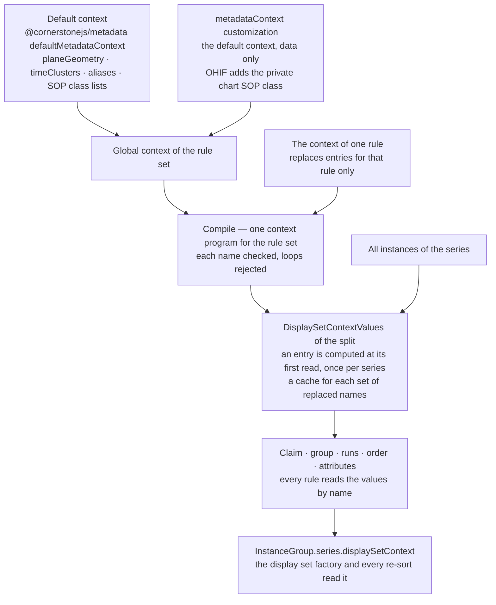

# Display set splitting — series context

**Prefix:** `SP` (split rules), groups `SP-SUM`, `SP-CTX`, `SP-SFN`, and `SP-EXM` — *proposed,
not yet reserved in the specification register.*
**Extends:** [Display set splitting — requirements](./requirements.md). The requirements of that
specification apply here too, in particular `SP-DET`, `SP-SAFE`, and `SP-REUSE`.
**Status:** Draft. §4 is under review. §5 is the recommended approach, and it can change.
**Affects:** `@cornerstonejs/metadata` (the split engine, the rule compiler, the series
functions), `@ohif/core` (`DisplaySetService`), `@ohif/extension-default` (the display set
factory, the example rule modules).
**Related:** [Display Set Splitting](../../../platform/services/customization-service/displaySetSplitting.md#the-metadatacontext-customization)
— the reference documentation for the series context.

---

## 1. Purpose

**The goal: let a rule use a value of the whole series in a decision about one instance.**

A split rule tests one instance at a time. Some data needs a test that depends on the other
instances of the series:

1. **A volume with some irregular images.** A series is a volume, except for some images that are
   not on the regular slice spacing. The regular slices must become one volume display set. The
   other images must stay as they are. To find the regular slices, the system must first find the
   slice spacing of the series. Then each slice is regular when its distance from a start point,
   in units of the spacing, is approximately an integer.
2. **A volume in spatial order.** The slices of a volume must be in order along the normal of the
   image plane, from one origin for the whole series. The order needs the origin and the normal
   first. Then each slice gets its distance along the normal.
3. **Ultrasound sweeps.** An ultrasound series holds the images of several sweeps, and each image
   records its acquisition time. Each run of images with no long gap in time must become one
   display set. The ranges of time must come from all of the times of the series.

The three cases have one shape. The system computes a summary of the series once. Then the
per-instance parts of the rules — the match, the grouping, the order, and the attributes — read
that summary. A summary can be expensive, so the system computes it once, and every rule that
needs it reads the same value.

Before this work, a series fact in the data form was a named boolean only. A rule in data could
ask "does this series mix two kinds of image?", but it could not compute a spacing, an origin, or
a range of time. Such a rule needed code.

## 2. Scope

### 2.1 How to read this specification

§4 states the **user requirements**: what the user must be able to do, or must be able to
determine, to work safely. §5 states the **implementation requirements**: how the work was done,
or the recommended approach.

You can change §5 freely when a better approach appears. You change §4 in two cases only: a
requirement describes the behaviour wrongly, or the intended user-facing behaviour changes. An
implementation that is inconvenient is never a reason to change §4.

### 2.2 In scope

- Series values that hold any value: a boolean, a number, or a summary object.
- One display set context that all rules of a split share, with entries that a rule can replace
  for itself.
- Named series functions for the summaries that the expression language cannot compute, and two
  built-in series functions: `planeGeometry` and `timeClusters`.
- The use of the series context in `attributes`.
- Three example rule modules, one for each case of §1.

### 2.3 Out of scope

- **A summary of the frames of one multiframe instance.** The engine splits whole instances
  (`SP-FIX-8` in the requirements specification).
- **A summary across two or more series** (`SP-FIX-7`).
- **Vector functions in the expression language**, for example `dot` or `cross`. The geometry is in
  the `planeGeometry` series function. See §6 item 5.

## 3. Definitions

**Series context.** The entries of the display set context that have the series scope: the named
values that the engine computes once from all of the instances of the series. A rule reads each
value by its name, in the same way as a DICOM keyword.

**Series fact.** One named value in the series context. This definition replaces the definition
in the requirements specification: a series fact can hold any value, not only a boolean.

**Series function.** A named function that computes one group of series values from all of the
instances of the series. Code supplies a series function. A context group names it.

**Slice lattice.** The positions along the normal of the image plane at a fixed spacing from an
anchor position. A slice is **on the lattice** when its position is within a tolerance of a
lattice position.

**Sweep.** A run of images, in time order, with no gap between two images that is longer than a
stated time.

*The system* means the OHIF Viewer, the `@cornerstonejs/metadata` split engine and rule compiler,
and their documentation, unless a requirement narrows it.

---

## 4. User requirements

> Change these only if a requirement describes the behaviour wrongly, or if the intended
> user-facing behaviour changes.

### 4.1 Summaries of a series — `SP-SUM`

**SP-SUM-1**
The system shall let a rule compute a value from all of the instances of a series, and use that
value in the match, the grouping, the order, and the attributes of each display set that the
rule creates.

**SP-SUM-2**
The system shall let a rule claim only the instances of a series that are on a regular slice
lattice, and leave the other instances of the series to the other rules.

> This is case 1 of §1. "Leave to the other rules" means that the other instances get the display
> sets that they get without the rule (`SP-FIX-6`).

**SP-SUM-3**
The system shall let a rule order the images of a display set by their distance along the normal
of the image plane, from one origin for the series.

**SP-SUM-4**
The system shall let a rule split the images of a series into display sets of contiguous
acquisition time, where a gap longer than a time that the rule states starts a new display set.

**SP-SUM-5**
WHEN two rules of a split use a series value of the same name, and neither rule replaces that
value or a value that it reads, the system shall give both rules the same value.

> Two rules can divide one series: "the regular slices" and "the other images". The two rules must
> agree on the lattice, so that each instance goes to exactly one of them. One value also means
> one computation of an expensive summary.

**SP-SUM-10**
The system shall let a rule replace a series value, or a value that it reads, for that rule only.
The other rules of the split shall keep the shared value.

> For example, one rule uses a gap of 20 seconds between ultrasound sweeps, and the other rules
> keep the default gap of 30 seconds. This requirement changed `SP-SUM-5`: before, the first rule
> that computed a name gave the value to every rule, and a rule could not have its own value.

**SP-SUM-6**
A rule shall be able to state every series value that it reads, so that the rule works alone, and
so that a reader of the rule sees where each value comes from.

**SP-SUM-7**
The system shall let a rule put a series value in the label or the series description of a display
set, for example the slice spacing.

**SP-SUM-8**
The system shall let a rule module that is only data, for example a URL module, express
`SP-SUM-2`, `SP-SUM-3`, and `SP-SUM-4`.

> A clinical user gets a rule from an assistant (`SP-DESC-1`). A rule that needs new code for
> each case does not follow that route.

**SP-SUM-9**
IF a rule names a series function that does not exist, THEN the system shall treat the rule as a
rule with an error, as `SP-SAFE-7` states.

> `SP-DET-1` and `SP-DET-2` apply to the series context too: a summary must not depend on the
> order in which the instances arrived. `SP-DET-3` also applies: when a late instance changes a
> summary, for example the slice lattice, the existing display sets keep their instances.

---

## 5. Implementation requirements

> Change these freely when a better approach appears. Cite the `SP-*` user requirements that each
> change continues to satisfy.

### 5.1 The shared series context — `SP-CTX`

The flowchart shows how the engine computes the values of the display set context for one split.



**SP-CTX-1**
`createDisplaySetSplitRules` shall compile one context program for a rule set: the entries of
`defaultMetadataContext`, then the entries of `options.context` over them. A rule shall
read a value by its name. *Satisfies `SP-SUM-1`, `SP-SUM-5`.*

**SP-CTX-2**
The engine shall compute an entry at its first read, one time for each series, and every rule that
does not replace the entry, or an entry that it reads, shall read the same value. *Satisfies
`SP-SUM-5`.*

> The cache key of an entry holds only the replaced names that the entry reads. So two rules that
> replace nothing share one computation of `planeGeometry`.

**SP-CTX-3**
The context of a rule shall replace a global entry of the same name for that rule only, also inside
the global entries that the rule reads, and it can define a new name. *Satisfies `SP-SUM-6`,
`SP-SUM-10`.*

> `"context": { "timeClustersMaxGap": 20 }` changes the gap of `timeClusters` for one rule, and
> `sweepStart` and the other aliases follow.

**SP-CTX-4**
A context entry in the data form shall have one of five forms. *Satisfies `SP-SUM-1`,
`SP-SUM-8`.*

| Form | Value |
| --- | --- |
| a number, a boolean, `null` or an array | A fixed value |
| a string | An expression. `series.instances.count(x)`, `.min(x)`, `.max(x)` and `.sum(x)` run over the instances of the series |
| `{ template }` | Text |
| `{ function, args? }` | A group: the value of a named series function, called with `(instances, { args })` |
| `{ attribute, vr?, vm? }` | A declaration of an attribute that the DICOM dictionary does not hold |

**SP-CTX-5**
A loop of context entries, an unknown name, and an unknown field of a group shall be compile
errors. *Satisfies `SP-SUM-6`, `SP-SAFE-7`.*

**SP-CTX-6**
`createDisplaySetSplitRules` shall take named series functions as `options.seriesFunctions`, in
addition to the built-in ones. A group that names an unknown function shall be a compile error
that names the rule, the path, and the known functions. OHIF shall pass the `seriesFunctions` of
the `useMetadataDisplaySet` customization, and the `metadataContext` customization as `context`. *Satisfies `SP-SUM-9`,
`SP-FORM-4`.*

**SP-CTX-7**
The display set factory shall pass the series context to `customAttributes` (the compiled
`attributes`) as `options.series`, and an attribute value shall read a context value by its name.
*Satisfies `SP-SUM-7`.*

**SP-CTX-8**
`DisplaySetService` shall pass the series context of a re-split to `extendInstances`, whichever
rule placed the new instances. *Satisfies `SP-DET-3`, `SP-SUM-1`.*

**SP-CTX-9**
A series function that gives a result for each instance shall give a map keyed by
`SOPInstanceUID`, else by `imageId`, and shall declare the field as an instance field. A rule
shall read the field by its path or its alias, for example `sliceIndex`, and gets the value of the
instance at hand. *Satisfies `SP-SUM-8`.*

**SP-CTX-10**
A series value that a rule uses in `groupBy` shall not be an ordinal. It shall be a value that
stays the same when a later group gets new instances, for example the start time of a sweep.
*Satisfies `SP-DET-3`.*

> The split key holds the `groupBy` values. An ordinal of a sweep changes when an earlier sweep
> arrives, and the display set then gets a different key.

**SP-CTX-11**
A value that only one rule needs should be an entry of the context of that rule. A value that two
or more rules must share should be a global entry. *Satisfies `SP-SUM-5`, `SP-SUM-6`.*

### 5.2 Series functions — `SP-SFN`

**SP-SFN-1**
The series functions shall be in `@cornerstonejs/metadata`, so that a server can use them without
OHIF. *Satisfies `SP-REUSE-1`, `SP-SRV-1`.*

**SP-SFN-2**
A series function shall be pure, and its result shall not depend on the order of the instances.
Its result shall be plain data: numbers, booleans, arrays, and maps. *Satisfies `SP-DET-2`,
`SP-REUSE-2`.*

**SP-SFN-3**
`planeGeometry` shall compute the slice lattice of a series in these steps. *Satisfies
`SP-SUM-2`, `SP-SUM-3`.*

1. The dominant orientation is the most frequent `ImageOrientationPatient`, rounded to 1e-3. A tie
   goes to the smaller text. The normal comes from the instance of that orientation with the
   smallest key.
2. Each instance of that orientation projects its `ImagePositionPatient` on the normal. The
   spacing is the most frequent gap between two consecutive distinct positions, rounded to
   0.01 mm. A tie goes to the smaller gap.
3. The anchor is the position that puts the most positions on the lattice. A tie goes to the lower
   position. So one extra slice at the edge does not move the lattice.
4. A position is on the lattice when its offset from the anchor, in units of the spacing, is
   within `args.tolerance` (default `0.1`) of an integer.
5. Index 0 is the lowest regular position, and `origin` is its position.

The result is `{ normal, origin, spacing, regularCount, irregularCount, positions, complete,
duplicates, distance, index }`. `distance` holds the distance in mm from the origin, for each
instance of the dominant orientation. `index` holds the lattice position of each regular
instance. `complete` is true when no lattice position between the first and the last is empty.

**SP-SFN-4**
`timeClusters` shall read the time of each instance from `AcquisitionDateTime`, else from
`AcquisitionDate` and `AcquisitionTime`, else from `ContentDate` and `ContentTime`. It shall sort
the times, with the key as a tie break, and shall start a new cluster after a gap of more than
`args.maxGap` seconds (default `30`). *Satisfies `SP-SUM-4`.*

The result is `{ time, start, first, clusters, untimedCount }`. `start` holds the start time of
the cluster of each instance, and so satisfies `SP-CTX-10`.

> No public DICOM date and time parser exists in the packages that `@cornerstonejs/metadata`
> uses: `@cornerstonejs/calculate-suv` has `parseDA` and `parseTM`, but its index does not
> export them. So `seriesFunctions.ts` holds a small parser, `dicomDateTimeToSeconds`. It ignores
> the time zone offset of a `DT`, and without a date it gives the time of day.

### 5.3 Example rule modules — `SP-EXM`

Each module is in `platform/app/public/customizations/split/`, and follows `SP-DEPLOY-1` and
`SP-DEPLOY-2`. `urlSplitModules.test.ts` compiles each module, and checks the display sets of one
series for each module.

**SP-EXM-1** — `split/regularVolume.jsonc`. *Satisfies `SP-SUM-2`, `SP-SUM-5`, `SP-SUM-7`.*

```jsonc
"regularVolume": {
  "priority": -2,
  "context": {
    "mixesIrregular": "planeGeometry.regularCount >= 3 && planeGeometry.irregularCount > 0 && planeGeometry.complete",
    "isRegularSlice": "sliceIndex != null"
  },
  "matches": {
    "isImage": true,
    "Modality": ["CT", "MR", "PT", "NM"],
    "mixesIrregular": true,
    "isRegularSlice": true
  },
  "groupBy": ["SeriesInstanceUID"],
  "sortBy": ["displaySet.sliceDistance"],
  "attributes": {
    "SeriesDescription": { "template": "{SeriesDescription} ({displaySet.sliceSpacing} mm)" }
  }
}
```

The module also holds the rule `irregularImages`, with priority `null`. With priority `-1`, that
rule puts the other images into one stack, with `"isRegularSlice": false`. Both rules read the
global `planeGeometry` group and replace no entry that it reads, so the engine computes the lattice
once (`SP-CTX-2`).

**SP-EXM-2** — `split/volumeProjectionOrder.jsonc`. *Satisfies `SP-SUM-3`.*

The module changes one field of the default `volume3d` rule with the standard `$set` command, so
the rule keeps its priority and claims the same instances:

```jsonc
"volume3d": { "sortBy": { "$set": ["displaySet.sliceDistance"] } }
```

An image that is not in the dominant plane has no distance, so it goes after the images that have
one (`SP-PIPE-7`).

**SP-EXM-3** — `split/usTimeClusters.jsonc`. *Satisfies `SP-SUM-4`, `SP-SUM-7`, `SP-CTX-10`.*

```jsonc
"usTimeClusters": {
  "priority": -1,
  "context": { "timeClustersMaxGap": 20 },
  "matches": {
    "isImage": true,
    "Modality": "US",
    "isMultiFrame": false,
    "sweepCount": { "greaterThan": 1 },
    "sweepStart": { "notNull": true }
  },
  "groupBy": ["SeriesInstanceUID", "sweepStart"],
  "sortBy": ["acquisitionSeconds"],
  "attributes": {
    "SeriesDescription": { "template": "{SeriesDescription} +{sweepOffset} s" }
  }
}
```

**The trace of `regularVolume`.** The table follows the rule through the stages of the pipeline
(`SP-PIPE` in the requirements specification), for a CT series of five instances: slices at 0, 2,
4, and 6 mm, and one extra slice at 3.1 mm.

| Stage | What happens |
| --- | --- |
| 6b | `regularVolume` runs first (priority −2), and its first read computes `planeGeometry`. `planeGeometry` finds the normal `[0, 0, 1]`. The gaps are 2, 1.1, 0.9, and 2, so the spacing is 2 mm. The anchor at 0 puts four positions on the lattice. The slice at 3.1 mm is 1.55 steps from the anchor, so it is off the lattice. `sliceIndex` is 0, 1, 2 and 3 for the slices at 0, 2, 4 and 6 mm. `mixesIrregular` is true. |
| 6c | `regularVolume` claims the four slices with an index. The slice at 3.1 mm has no index, so the default `volume3d` rule claims it. |
| 6d | Two groups: `["regularVolume", <SeriesInstanceUID>]` with four slices, and `["volume3d", <SeriesInstanceUID>]` with one slice. |
| 6e | The four slices are in the order of `sliceDistance`: 0, 2, 4, 6 mm. |
| 7 | The series description of the volume display set ends with ` (2 mm)`. |

A series with slices at 0, 2, and 4 mm only has `irregularCount` 0, so `mixesIrregular` is false,
and the series keeps the default `volume3d` display set (`SP-FIX-6`).

---

## 6. Open questions

| # | Question | State |
| --- | --- | --- |
| 1 | Two rules can declare one name with two different definitions. | **Resolved.** A rule context replaces the entry for that rule only (`SP-CTX-3`), so each rule reads its own definition. |
| 2 | A late instance can change a summary: it can change the slice lattice, or it can join two sweeps. The existing display sets keep their instances (`SP-DET-3`), so the result can differ from a split of the complete series. | **Accepted.** The reference documentation states it, with an example of two sweeps. |
| 3 | A series fact sees every instance of the series, also the instances that an earlier rule claims. In `usTimeClusters`, a multi-frame clip counts in the time clusters, and can join two sweeps. Must a fact take a filter of the instances? | **Open.** A possible form is an optional `where` condition on a series fact. |
| 4 | The anchor search of `planeGeometry` takes a time proportional to the square of the number of distinct positions. | **Open.** The time is small for a series of a few thousand slices. A faster search can replace it, and `SP-SFN-3` stays the same. |
| 5 | Must the expression language get vector functions, for example `dot` and `cross`? | **Open.** Not needed for the three cases, because `planeGeometry` gives `distance`. |
| 6 | `DisplaySetService` keeps the compiled rules for one `splitRules` value. A change of `seriesFunctions` alone does not compile the rules again. | **Accepted.** A mode that defines other rules gives a new `splitRules` object, which compiles again (`SP-PIPE-2`). |
| 7 | The `series` list of a rule is gone. A custom rule set in the earlier form does not compile. | **Accepted.** The feature is off by default, and no release of OHIF holds it. The earlier form must be stated in the release notes of `@cornerstonejs/metadata`. |
| 8 | The prefix groups `SP-SUM`, `SP-CTX`, `SP-SFN`, and `SP-EXM` must go into the specification register (`specs/index.md`). | **Deferred**, as §6 item 5 of the requirements specification. |

## 7. Traceability

| Requirement group | Source |
| --- | --- |
| `SP-SUM` | The three cases of §1: a regular lattice in an irregular series, a spatial order from one origin, and ultrasound sweeps by acquisition time |
| `SP-SUM-5`, `SP-CTX-1`, `SP-CTX-2` | The decision that the series context is shared across the rules |
| `SP-SUM-10`, `SP-CTX-3` | The `@cornerstonejs/metadata` display set context, in which the context of a rule replaces an entry for that rule only |
| `SP-SUM-8`, `SP-SFN-1` | `SP-DESC-1`, `SP-REUSE-1`, and `SP-SRV-1` of the requirements specification |

## 8. Verification

The tests fall in two groups: "the API must do this" (`displaySetRules.test.ts` and
`seriesContext.test.ts` of `@cornerstonejs/metadata`), and "the user must see this"
(`urlSplitModules.test.ts`).

| Requirement | Test |
| --- | --- |
| `SP-CTX-1`, `SP-CTX-2`, `SP-SUM-5` | `displaySetRules.test.ts`: "computes an entry one time for each series for all rules that do not replace it" |
| `SP-SUM-10`, `SP-CTX-3` | `displaySetRules.test.ts`: "lets a rule context replace an argument for that rule only, also inside the global entries" |
| `SP-CTX-4` | `displaySetRules.test.ts`: "runs min, max, sum and count over the series in a series entry" |
| `SP-SUM-9`, `SP-CTX-5` | `displaySetRules.test.ts`: "rejects a loop of entries, an unknown group field, and a group replaced by a value" |
| `SP-SUM-7`, `SP-CTX-7` | `seriesContext.test.ts`: "splits the lattice from the other images, and labels each display set from the whole series" |
| `SP-SFN-2`, `SP-SFN-3` | `seriesContext.test.ts`: the `planeGeometry` tests, one of them with the instances in reverse order |
| `SP-SFN-4` | `seriesContext.test.ts`: the `timeClusters` test |
| `SP-SUM-2`, `SP-EXM-1` | `urlSplitModules.test.ts`: "regularVolume makes a volume of the regular slices, and leaves the extra slice", and "regularVolume keeps a fully regular series as the default volume" |
| `SP-SUM-3`, `SP-EXM-2` | `urlSplitModules.test.ts`: "volumeProjectionOrder orders the slices by position, not by InstanceNumber" |
| `SP-SUM-4`, `SP-EXM-3` | `urlSplitModules.test.ts`: "usTimeClusters makes one display set for each sweep, in time order" |
| `SP-CTX-8` | `DisplaySetService.test.ts`: "passes the series facts of the re-split to the display set it extends" |
| `SP-DET-3` with a changed summary | *Pending* — a `DisplaySetService` test that adds a late slice which changes the lattice |
