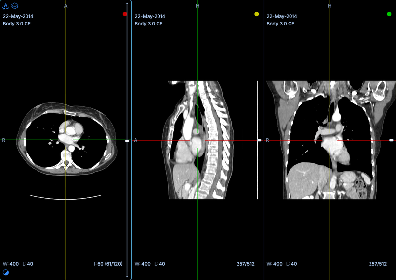
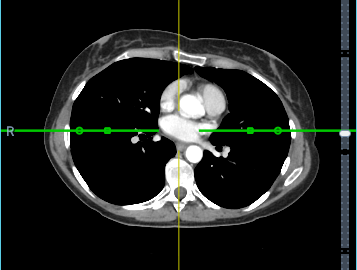
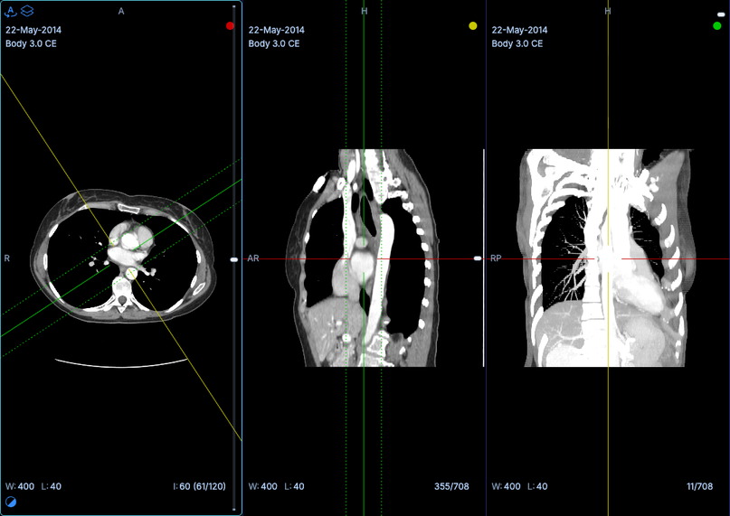
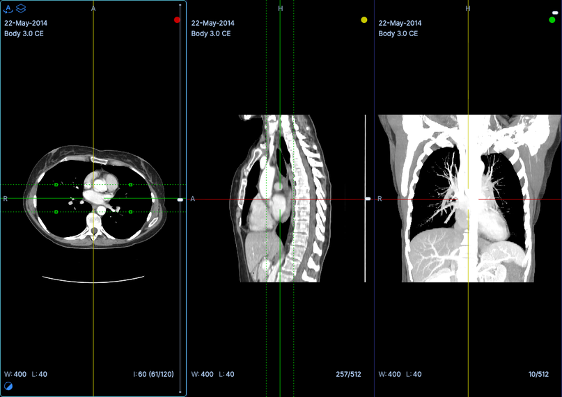

# Multiplanar Reconstruction

Multiplanar reconstruction (MPR) shows a series as a volume in three planes at
once: axial, sagittal and coronal. It works for series that can be loaded as a
volume, such as a CT or MR series made of parallel slices.

To open it, select **MPR** in the layout menu of the toolbar. The series in the
active viewport opens in three viewports, one per plane. To go back, select
another layout.

## Crosshairs

Select the **Crosshairs** tool in the toolbar. Each MPR viewport then shows two
reference lines, one for each of the other two planes, drawn in that plane's
colour. The point where the lines cross is the same point in all three
viewports.

- Drag the centre, where the lines cross, to move that point. The other
  viewports move to it.
- Drag a reference line to move only that plane.

Hovering over a reference line shows its handles: round ones near the ends of
the line, and square ones closer to the centre.

## Oblique MPR

Drag a round handle to rotate the crosshairs. The other two viewports then show
oblique planes through the volume, at the angle of the rotated lines.

## Slab MPR

Drag a square handle away from its line to give that plane a thickness. Two
dashed lines mark the slab, and the viewport for that plane shows a maximum
intensity projection (MIP) of the slices inside it instead of a single slice.
Drag the handle back to the line to return to a single slice.

